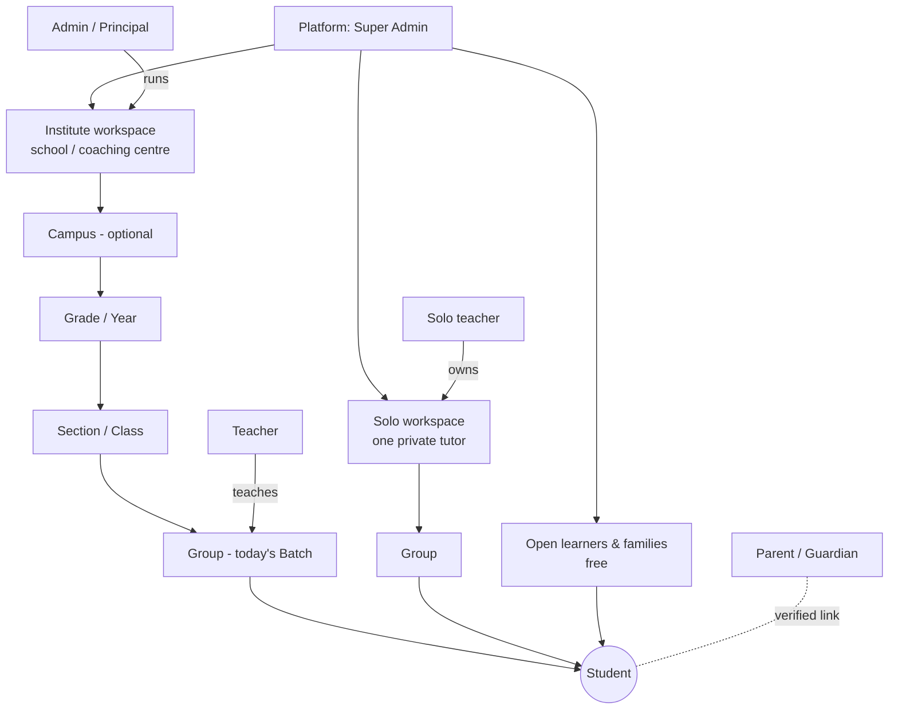
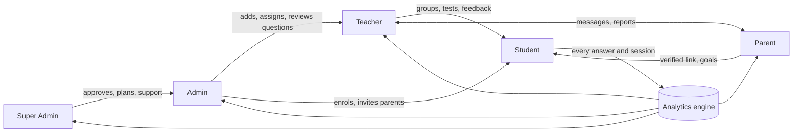

# Learnigo roles roadmap: Parents, Teachers, Admins, Super Admin

This folder is the build plan for turning Learnigo from a learning site into a
platform that **families use for free, individual teachers can buy, and
schools and institutes can buy**, with one codebase serving all three.

| File | What it plans |
|---|---|
| [FOUNDATIONS.md](FOUNDATIONS.md) | Shared work every role depends on: accounts, linking, the organisation tree, permissions, plans and feature modules, the analytics engine, privacy. **Start here.** |
| [DESIGN.md](DESIGN.md) | The visual system for every dashboard: navigation, time ranges, drill-down, chart catalogue, wireframes and quality bars. |
| [PARENT.md](PARENT.md) | Parents linked to their children, with in-depth daily, weekly, monthly and yearly analysis and usage logs. |
| [TEACHER.md](TEACHER.md) | Private tutors and school teachers: questions, groups, tests and test rules, and performance at every level. |
| [ADMIN.md](ADMIN.md) | The school principal / institute owner: builds the tree of staff and students and sees performance at every level. |
| [SUPER_ADMIN.md](SUPER_ADMIN.md) | Us: monitor and control everything on the platform. |

---

## 1. One platform, three ways to use it

- **Open learners & families (free):** anyone can learn. A parent links to their
  child and gets the parent dashboard. No school is needed.
- **Solo workspace (sold to individual teachers):** a private tutor signs up on
  their own and runs their own groups, question bank, tests and reports. Under
  the hood this is a one-person organisation, so every institute feature also
  works for them without a second code path.
- **Institute workspace (sold to schools and coaching centres):** a principal
  builds the tree (campus → grade → section → group), adds teachers and
  students, and invites parents. They see everything below them.

The same student can belong to several workspaces at once: their school, a
private tutor in the evening, and their own free learning at home. Each
workspace sees **only the activity that belongs to it**, while parents
see the whole child (see [FOUNDATIONS.md § Visibility](FOUNDATIONS.md#f4-visibility-who-sees-what)).

## 2. How the roles connect

Every arrow above is a task in one of the role files. The links that make
the system feel joined up:

| Event | Who sees it, and where |
|---|---|
| Teacher assigns a test | Student: "To do" list. Parent: notification and calendar. Admin: test activity for the school. |
| Student finishes a session | Parent: timeline and daily story. Teacher: group heatmap. Admin: rollups. Super admin: platform activity. |
| Student falls behind (at-risk rule) | Teacher: "Needs attention". Parent: gentle nudge with a suggestion. Admin: at-risk list. |
| Teacher uploads questions | Admin: review queue (Institute). Solo: auto-approved. Super admin: public-bank review if the teacher shares them publicly. |
| Admin adds a parent to a student | Parent: email invite, then a verified link with no codes needed. |
| Parent messages a teacher | Teacher: inbox. Admin: messaging metrics (not the content, unless the school's policy allows). |

## 3. Who can do what (summary)

`✓` = yes, `own` = only things they created or are assigned to, `—` = no.

| Capability | Student | Parent | Solo teacher | Inst. teacher | Admin | Super admin |
|---|---|---|---|---|---|---|
| Learn, play, AI Teacher | ✓ | — | preview | preview | preview | ✓ |
| See a child's in-depth analytics | self | linked children | own students | own groups | whole org | all (audited) |
| Create questions | — | — | ✓ auto-approved | ✓ needs approval | ✓ | global bank |
| Create groups | — | — | ✓ | if allowed by policy | ✓ | — |
| Create tests and rules | — | — | ✓ | ✓ | ✓ | templates |
| Add teachers / students | — | add own child | add own students | — | ✓ | ✓ |
| Teacher performance | — | — | — | self | ✓ | ✓ |
| Plans, billing, feature modules | — | own plan | own plan | — | org plan | ✓ all |

The full permission matrix lives in [FOUNDATIONS.md § F3](FOUNDATIONS.md#f3-permissions-one-rule-engine).

## 4. Selling it: plans built from feature modules

Each feature belongs to a **module** with an entitlement key such as
`analytics.deep` or `tests`. A plan is just a list of modules, so the same build
can be sold in any combination. Proposed plans (pricing still to be decided):

| Plan | For | Modules |
|---|---|---|
| **Free** | Students, families | `core.learning`, `family.link`, `analytics.basic`, `ai.teacher` |
| **Family Plus** *(optional, to decide)* | Parents who want more | + `analytics.deep` history beyond 90 days, PDF reports, year-in-review |
| **Solo Free** | Tutors trying it out | 1 group, up to 15 students, `groups`, `qbank.author`, `tests` |
| **Solo Pro** | Private tutors | Unlimited groups, `tests.advanced`, `analytics.deep`, `reports.branded`, `comms` |
| **Institute** | Schools, coaching centres | All Solo Pro modules + `org.tree`, `org.analytics`, `staff.roles`, `comms.policy`, per-student seats |
| **Enterprise** | Groups of schools, districts | + `org.campus`, `sso`, `api.export`, data-processing agreement (DPA), priority support |

See [FOUNDATIONS.md § F5](FOUNDATIONS.md#f5-plans-modules-and-entitlements) for the entitlement system.

## 5. Order of work

| Phase | Goal | Main items |
|---|---|---|
| **0: Safe to sell** (must-do) | No data leaks; the base is in place | FND-001 parent-link security fix; FND-010–FND-014 accounts and verified linking; FND-020 permission engine with tests; FND-030 entitlements skeleton; FND-040–FND-043 metrics dictionary and daily rollups |
| **1: Wow for families and tutors** | Parents amazed; tutors can sign up and pay | PAR P0/P1 items; TCH Solo onboarding, groups, question editor, test builder; DSN shell and chart kit |
| **2: Schools** | Sell to institutes | ADM tree builder, bulk import, staff roles, school analytics, teacher performance, reports; TCH test rules and grading; billing for seats |
| **3: World scale** | Enterprise, insight, delight | SUP platform console; SSO; integrations; narrative insights; year-in-review; benchmarks; public API |

## 6. How to use these TODOs

- Every item has an ID (`FND-`, `DSN-`, `PAR-`, `TCH-`, `ADM-`, `SUP-`), a
  priority and scope tags:
  - **Priority:** `P0` must ship before selling, `P1` launch, `P2` growth / wow.
  - **Scope:** `Family`, `Solo`, `Institute`, `Platform`. Which kind of workspace the item serves.
  - **Module:** the entitlement key that turns the feature on (`module analytics.deep`).
  - **needs:** IDs this item depends on.
- Tick the checkbox in the same PR that ships the item, and link the PR.
- Use the shared words below in code, UI and docs.

### Glossary (and today's names in the code)

| Word in these plans | Today in code | Meaning |
|---|---|---|
| Organisation / workspace | `Organization` (adminDb **and** a mirror in superAdminDb) | A tenant: Solo or Institute |
| Admin | `OrgAdmin` | Principal or owner of an organisation |
| Teacher | `Tutor` (a Tutor who has logged in) | Teaches groups; in Solo they are also the admin |
| Group | `Batch` (adminDb) | A set of students taught together |
| Unit | *(new)* | A node in the org tree: campus, grade, section, department |
| Learner | `Student` (adminDb) + activity keyed by **email** (default DB) | The person learning |
| Parent | `ParentAccount` + `Child` (self-serve) **and** `admin/Parent` (school-added). Today these two are **not connected** | Guardian of a learner |
| Super admin | Single account from env vars | Platform staff |

Read [docs/design-guide.md](../design-guide.md) first: it explains the
three-database setup, the three login systems and the conventions that
these plans build on.
